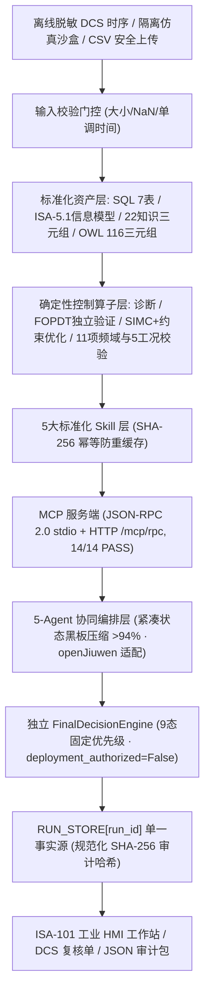

# 系统蓝图设计文档（Reference 02 · V4.0）

## 1. 总体分层架构（决策层与大模型物理隔离）

## 2. 独立 FinalDecisionEngine 9 态固定优先级流转
1. `INPUT_DATA_INVALID`（非法/NaN/乱序/越界输入）
2. `SIMULATION_TIMEOUT`（仿真或工具超时/运行异常）
3. `AUDIT_INCOMPLETE`（审计字段缺失或哈希不一致）
4. `HEALTHY_NO_CHANGE`（健康回路保持原参数）
5. `VALVE_MAINTENANCE_REQUIRED`（调节阀粘滞机械故障）
6. `MODEL_VALIDATION_FAILED`（`C-000` 未通过或模型未评估）
7. `SAFETY_REJECTED`（`C-001`–`C-010` 任一硬约束或 5 工况未通过）
8. `PERFORMANCE_NOT_IMPROVED`（性能未净改善或外部周期扰动）
9. `SIMULATION_VALIDATED_PENDING_ENGINEERING_REVIEW`（全部门控通过，待人工复核）
