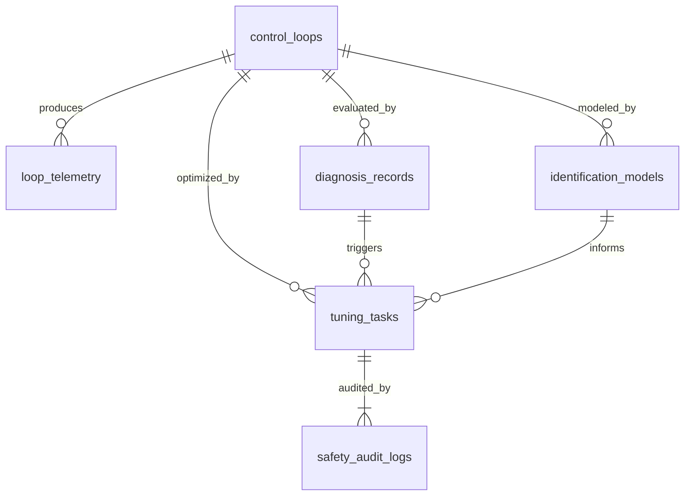

# PetroPID 数据模型说明、数据字典与 ER 关系

## 1. 实体关系图 (ER Diagram)

## 2. 核心表数据字典
| 表名 | 主键 | 外键 | 核心业务用途 |
| :--- | :--- | :--- | :--- |
| `control_loops` | `loop_id` | — | 存储 5 大石化装置控制回路主数据、位号与初始 PID 参数 |
| `loop_telemetry` | `telemetry_id` | `loop_id` | 存储清洗脱敏后的 DCS 秒级时序（SP/PV/OP/ERR） |
| `diagnosis_records` | `diag_id` | `loop_id` | 留存 Harris 指数、OI、粘滞指数与根因诊断结论 |
| `identification_models` | `model_id` | `loop_id` | 留存 FOPDT 过程模型 `(K, tau, theta)` 及独立验证集准确率 |
| `tuning_tasks` | `task_id` | `loop_id, diag_id, model_id` | 记录多智能体协作整定任务、推荐参数与性能改善幅度 |
| `safety_audit_logs` | `audit_id` | `task_id` | 100% 留存 10 项安全硬约束及多工况验证逐项审计溯源 |

## 3. 迁移脚本
- 初始化迁移脚本：`03_models/data_model/migrations/001_init.sql`（与 `schema.sql` 保持同步）。
