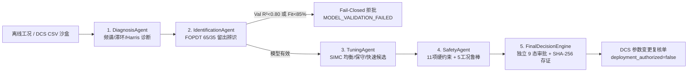

# PetroPID-Agent V4.3.3 技术方案说明书

> **参赛赛道**：第二届石油和化工行业人工智能创新大赛 · 智能体赛道 · 赛题 5（面向复杂化工过程的多智能体协作自适应 PID 控制回路诊断与智能整定）  
> **源码仓库**：https://github.com/zhud41343-alt/PetroPID-Agent  
> **公网实测**：https://petropid-agent.onrender.com  
> **版本基线**：后端算法/安全/审计冻结基线 `d8efc92c3ec78a207919a307b23f15b82e01dba6`；代码最终冻结基线 `07534e3bb217340124ff73d4d7e29233e238dc7b`（GitHub Actions CI Run `45362645906` 全绿）  
> **安全边界声明**：**本项目所有控制实验均在隔离机理仿真环境、脱敏离线数据与测试沙盒中完成，绝不连接、操作或修改真实 DCS/PLC 及生产设备；所有仿真通过的候选参数均锁定 `deployment_authorized=false`，仅进入“待自控工程师人工复核”状态。**

---

## 1. 行业痛点与工程定位

在石油化工连续生产装置（常减压精馏塔 CDU、催化裂化 FCC、乙烯裂解炉、连续搅拌釜 CSTR、加氢精制等）中，PID 控制回路长期面临四类典型工程隐患：
1. **参数激进振荡与保守迟缓**：原油性质切换、负荷调整导致对象增益/时滞漂移，引发超调振荡或跟踪迟缓，增加能耗与调节阀机械磨损；
2. **执行机构硬件故障（调节阀粘滞）**：阀杆填料摩擦引起的矩形滞环振荡无法通过调 PID 根除，盲目增大比例增益反而加剧阀位磨损；
3. **外部周期性工艺扰动与未测负载阶跃**：上游压缩机脉动或未测扰动会污染辨识数据，若强行拟合 FOPDT 模型并整定，极易生成危险发散参数；
4. **传统 AI/自动整定工具的“敢调不敢拒”风险**：直接用黑盒大模型输出 PID 参数缺乏数学稳定裕度保障与可审计证据链，难以获得石化自控工程师信任。

**PetroPID-Agent 的核心工程定位**：不是取代自控工程师“自动下发参数”，而是构建一套**“诊断有据、辨识留出验证、安全硬约束兜底、证据不可篡改、宁拒不乱调（Fail-Closed）”**的离线仿真决策支持工作站。

---

## 2. 系统总体架构与五阶段多智能体真实职责

系统采用 **确定性数学/安全内核 + 紧凑共享状态黑板 + 独立审批决策引擎** 的分层架构（高清矢量架构图见 [02_ARCHITECTURE_DIAGRAM.svg](./02_ARCHITECTURE_DIAGRAM.svg)）：

### 大模型与确定性引擎的严格职责边界
- **大模型（DeepSeek `live_llm_api`）**：仅承担自然语言诊断解释、工艺语境辅助总结与交互式工程指令解析（当无 API Key 或网络受限时自动降级为确定性规则说明，不影响核心计算与安全裁决）。
- **确定性数学与安全引擎（`04_algorithms/` & `07_agents/decision_engine.py`）**：全部故障指标计算（OI / IAE / Harris / 粘滞指数 SI）、65/35 FOPDT 最小二乘辨识、SIMC 整定、11 项硬约束与 5 工况鲁棒仿真、以及 9 态最终状态裁决**完全由确定性代码执行**，大模型无法绕过任何安全门控。

---

## 3. 核心算法、11 项安全硬约束与 9 态 Fail-Closed 决策机制

### 3.1 65/35 独立留出辨识与 `C-000` 模型置信门控
- 将采集时序严格按前 65% 训练段拟合 FOPDT 模型 `(K, τ, θ)`，在后 35% 独立验证段计算拟合度 `Fit%` 与决定系数 `R²`。
- **`C-000` 模型可信度硬门控**：凡 `val_r2 < 0.80` 或 `val_fit_pct < 85.0%` 或数据激励不足，立即阻断后续整定，输出 `MODEL_VALIDATION_FAILED`，保持原 DCS 参数不变。

### 3.2 11 项安全硬约束与 5 工况跨边界鲁棒验证
候选参数必须同时满足：
- **参数边界约束（C-001 ~ C-003）**：`Kc ∈ [0.05, 8.0]`、`Ti ∈ [1.5, 200.0]s`、`Td ∈ [0.0, 20.0]s`；
- **频域鲁棒裕度（C-004 ~ C-006）**：增益裕度 `GM ≥ 1.8`、相位裕度 `PM ≥ 35°`、最大敏感度峰值 `Ms ≤ 2.2`；
- **时域与执行机构约束（C-007 ~ C-010）**：标称超调红线、调节阀行程与磨损率上限、5 工况（标称 + 增益/时滞/时间常数摄动）跨边界专用超调/振荡红线。

### 3.3 独立 9 态状态机与不可篡改审计存证
`FinalDecisionEngine` 统一输出 9 种机器枚举状态（其中无任何状态授权自动下发真实 DCS）：
- `SIMULATION_VALIDATED_PENDING_ENGINEERING_REVIEW`（仿真通过，待人工复核）
- `HEALTHY_NO_CHANGE`（运行健康，无需变更）
- `MODEL_VALIDATION_FAILED` / `VALVE_MAINTENANCE_REQUIRED` / `PERFORMANCE_NOT_IMPROVED` / `SAFETY_REJECTED` / `INPUT_DATA_INVALID` / `SIMULATION_TIMEOUT` / `AUDIT_INCOMPLETE`
- 每次运行生成全局唯一 `run_id`、规范化输入输出 SHA-256 哈希、全记录摘要 `record_digest_sha256` 与 `verify_audit_record()` 完整性校验；跨回路 `run_id` 导出复核单强制返回 `HTTP 409 Conflict`。

---

## 4. 领域知识工程与协议集成

- **OWL 本体与知识图谱（`03_models/`）**：构建石化 PID 故障诊断与安全约束本体（**116 条 RDF 三元组**、**7 张 SQL 审计/回路结构表**、**22 条规则知识三元组**），由 `validate_models.py` 在 CI 中自动校验。
- **MCP JSON-RPC 2.0 协议（`06_mcp/`）**：封装标准工具调用服务，`mcp_client.py` 自动化集成测试 **14/14 PASS**。
- **openJiuwen 框架适配说明**：如实区分环境——本地安装原生 SDK 时执行原生工具层注册测试；在轻量化 Linux CI 环境中安全运行于兼容运行时（CI 中 1 项原生 SDK 测试标注 `skipped`，不伪造原生通过）。

---

## 5. 科研实验验证与诚实统计披露

### 5.1 30 回路石化基准（5 大装置 × 6 类工况）
- **故障诊断准确率**：**30/30（100.0%）**；
- **保守安全决策率 / 危险参数误放行率**：**30/30（100.0%）** / **0/19（0.0%）**；
- **独立全任务精确匹配率**：**24/30（80.0%）**（低于 90% 理想目标，如实披露）：其中 `LOOP-012 ~ LOOP-017`（6 个保守迟缓回路）训练段 `train_r2 = 0.966–0.972`，但验证段存在 `+0.31～+0.32` 未测负载阶跃偏移导致 `val_r2 = 0.51–0.60`，系统坚持 Fail-Closed 拒绝整定，不降低验证门槛。
- **11 个仿真通过待复核回路平均改善**：振荡指数 `OI` 降幅 `-96.05%`，跟踪误差 `IAE` 降幅 `-95.48%`，5 工况跨边界通过率 `100%`。

### 5.2 40 样本 SOPDT 跨模型泛化与严格留出盲测
- 严格分层：`original_12 (12)` + `v42_regression_12 (12)` + `v43_regression_8 (8)` + **零调参严格留出集 `OOD-33..40 (8)`**（不把回归集混称盲测）。
- **全量 40 样本**：诊断 `38/40 (95.0%)`、错误健康 `0/40`、错误参数推荐 `0/24`（Clopper-Pearson 95% 单侧置信上界 `≤ 11.73%`，不宣称工业风险为零）。
- **严格留出 8 样本**：诊断 `7/8 (87.5%)`、错误健康 `0/8`、错误参数推荐 `0/8`；失败样本 `OOD-36`（真实阀门粘滞判为保守迟缓后被模型验证拦截拒批，安全拒绝正确、故障分类错误）如实保留。

### 5.3 144 次模块因素消融与 B1/C 等价审计（`03_ABLATION_120_RAW_TRIALS.json`）
B1 与 C 均通过同一套 `verify_audit_record()` 验证（并通过 8 类相同字段篡改故障注入测试），6 组各 24 次共 144 次原始实验由 `recompute_ablation.py` 在 CI 中独立复算：

| 对照组 | 决策正确率 | 故障恢复率 | 重复工具防重 | 审计验真率 | 序列化交接均值 (B) | 估算 Token (`B/4`) | P50 延迟 (ms) |
| :--- | :---: | :---: | :---: | :---: | :---: | :---: | :---: |
| `A0` 固定基线 | 75.0% | 0.0% | 0 | 0.0% | 15,023 | 3,756 | 36.14 |
| `A1` +重试 | 100.0% | 100.0% | 0 | 0.0% | 15,023 | 3,756 | 127.63 |
| `A2` +重试+缓存 | 100.0% | 100.0% | 6 | 0.0% | 15,023 | 3,756 | 128.07 |
| `B1` 单体+真实审计 | 95.83% | 100.0% | 6 | 100.0% | 11,463 | 2,866 | 142.62 |
| `B2` 单体+紧凑黑板+审计 | 95.83% | 100.0% | 6 | 100.0% | 201 | 50 | 136.55 |
| `C` 五阶段黑板+审计 | **100.0%** | **100.0%** | **6** | **100.0%** | **2,632** | **658** | **172.12** |

**严谨科研结论**：容错恢复主要由重试机制贡献，重复调用削减由缓存贡献，交接体量压缩主要由紧凑黑板结构贡献（而非单纯归因于多智能体）；五阶段协作相比单体增加约 `30–36 ms` P50 编排开销，换取明确的阶段职责隔离、独立安全审批与全链路结构化审计（24/24 vs 23/24 仅 1 例差异，不夸大为大样本统计显著优势）。

### 5.4 外部公开真实工业控制回路只读评估（ISDB · 76 化工/炼油回路，零调参）
- 使用阿尔伯塔大学公开 `isdb10.mat`（SHA-256: `4dd329b5af3f9bd6e9070bce3fd46e001bb763a21c9fb8be026571b9d364e7df`，单回路最多截取前 1500 点，不修改任何冻结阈值）开展只读探索性评估（详见 [04_ISDB_EXTERNAL_INDUSTRIAL_EVAL.md](./04_ISDB_EXTERNAL_INDUSTRIAL_EVAL.md)）：
  - **未知过程真值门禁一致性**：全部 76 条外部输入（`has_known_plant_truth=False`）均未输出参数变更放行结论（`0/76`），`deployment_authorized=true` 为 `0/76`，流水线返回 `audit_status = PASS` 为 `76/76`（验证预设门禁执行一致性，不作为真实闭环安全性的统计证明）；
  - **零调参粘滞诊断域迁移表现**：10 条明确粘滞回路异常检出 `9/10 (90.0%)`；二分类粘滞敏感性对照在 16 回路严格子集（6 条明确 `no stiction`）上为 Recall `50.0%` / Precision `55.56%` / F1 `52.63%`，在 28 回路启发式分组上为 Recall `50.0%` / Precision `33.33%` / F1 `40.0%`，如实界定了当前轻量时域诊断器在恒定设定值真实炼厂数据上的适用边界。

---

## 6. 工业 HMI 工作站与全链路自动化回归

- **界面设计原则**：参考 ISA-101 高性能 HMI 设计原则与 ISA-5.1 仪表标识规范，采用哑光灰蓝工业配色，颜色严格保留给异常与告警态；提供 5 大装置回路树、30 回路离线仿真基准热图、ISA-5.1 P&ID 迷你面板、时域 `±2% ΔSP` 参考带、带滞环方向箭头的 PV-OP 相图、带 `|L|=1` 单位圆与 `GM/PM/Ms` 读数框的 Nyquist 图，以及压力沙盒一键 CSV（含缺列 400 拦截示例）。
- **前端 Fail-Closed 双重保护**：仅当 `final_status`、有效 `run_id`、`audit_status === 'PASS'` 且真实存在 `≥11` 项全部通过的约束记录时才允许展示绿色复核横幅；HTTP 请求失败立即清空旧 `currentData` 并禁用导出按钮。
- **自动化 CI 门禁（最新全绿 Run `45367547675`）**：GitHub Actions 在每次提交自动执行 `pytest`（Linux CI `40 passed, 1 skipped`；本地 `41 passed`）、`node --check`、**真实无头 Chromium Playwright E2E 回归（含 HTTP 500 清除旧态与篡改审计响应拦截负向测试、1440×900 与 1366×768 双视口校验）**、`14/14 MCP`、OWL/SQL/KG 校验、30 回路基准与 144 次消融复算。

---

## 7. 诚实局限性与后续工业落地路径

1. **当前局限**：现有 30 回路基准与 40 样本 SOPDT 泛化集均为隔离机理仿真数据；在外部真实炼厂 ISDB 76 回路只读测试中，轻量时域粘滞诊断器存在明显跨域落差（严格子集 F1 52.63% / 启发式分组 F1 40.0%），且尚未开展真实炼厂多变量强耦合（MIMO）与在线闭环运行验证；0/24 错误推荐在统计学上仅给出 `≤11.73%` 的 95% 单侧上界，不代表真实装置零风险。
2. **落地路径**：已完成公开 ISDB 76 回路只读探索性评估；后续按「目标炼厂历史离线镜像库阈值标定与影子运行（Shadow Mode） → 经装置工艺/自控双签 MOC 流程人工复核下发」两阶段渐进推进，始终严守离线辅助与人工审批红线。
